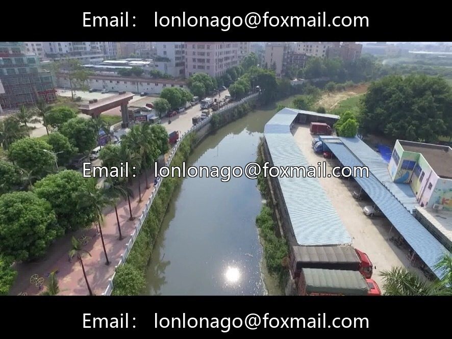
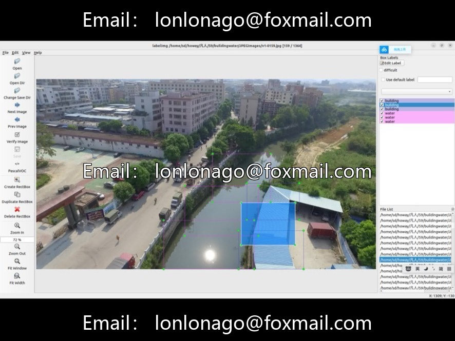
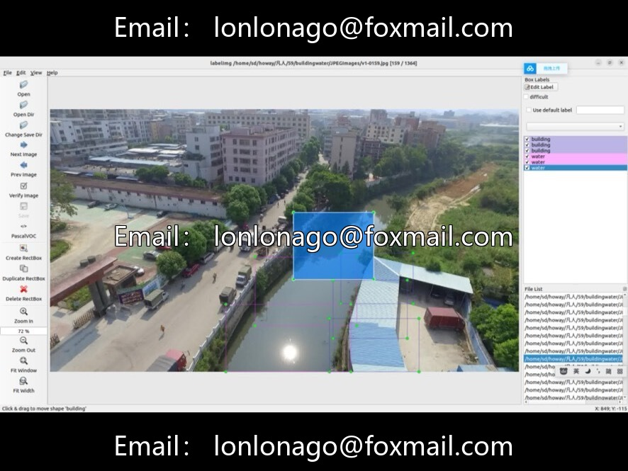
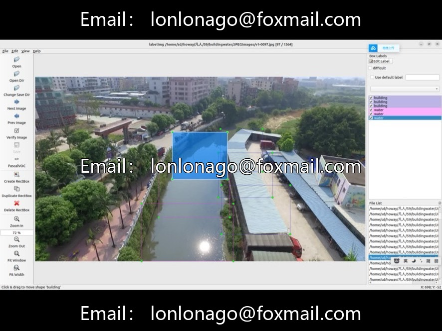
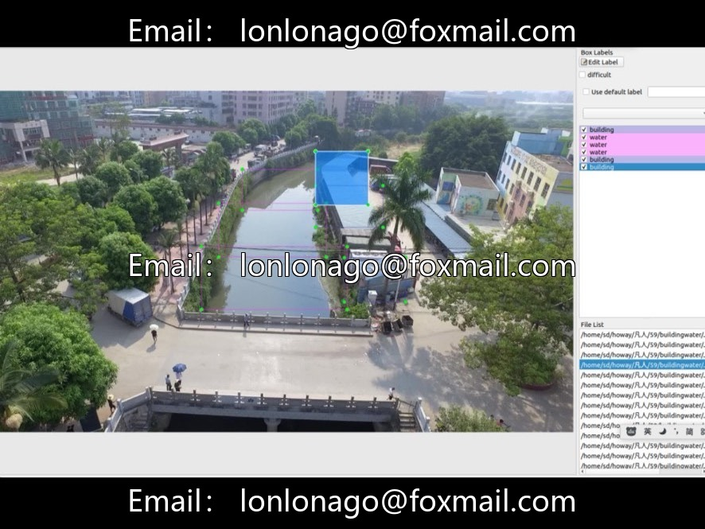
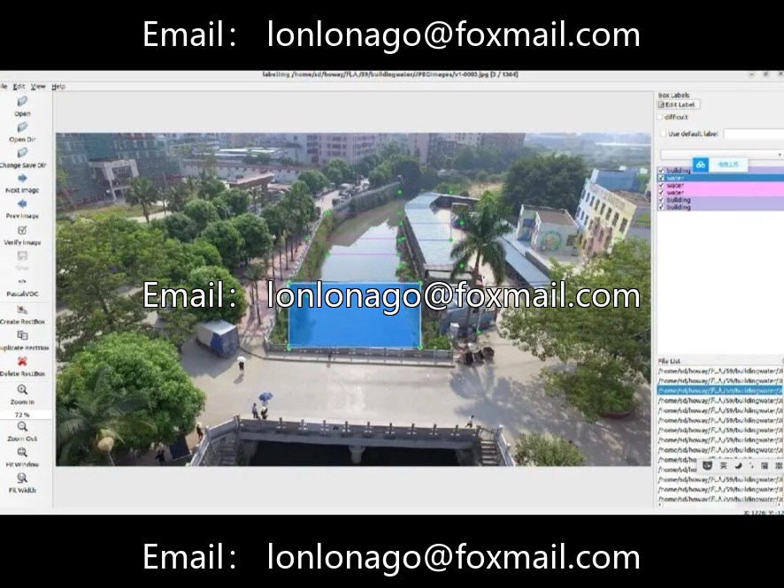

# Drone Unauthorized Construction + River Monitoring Dataset | Hydraulic Survey Materials

## Body

Drone Unauthorized Construction + River Monitoring Dataset | Hydraulic Survey Materials

Urban-rural aerial photography of illegal constructions, river channel disorder integration target detection dataset for land and water resources projects directly trained✅

Core Parameters Quick Overview

▪️ Total image count: 1364, including aerial photography and real-world shots
▪️ Two types of annotations
Building violations: private construction, rooftop extensions, land/green space infringement, 3288 annotated boxes
Waterway issues: floating trash, sewage outlets, illegal docks, obstructions to water flow, 3389 annotated boxes
▪️ Total number of annotated boxes: 6677, with an average of about 4.89 targets per image
▪️ Native VOC format, can be converted to YOLO txt with scripts
▪️ Some images simultaneously contain both building and waterway targets, closely aligned with real inspection scenarios

Data set advantages

Domestic real-scene aerial photography materials, with multiple angles and high resolution; Professional and precise labeling, no need for extensive cleaning; A set of data supports two major services: the investigation of illegal constructions on land and the ecological inspection of river channels.

Four major ground applications

1. Natural Resources Patrol: Automated identification of illegal construction on arable land and green spaces.

2. River Channel Four Irregularities Monitoring: Investigation of unauthorized construction, unauthorized dumping, sewage discharge, and floating debris.

3. Hydraulic Digital Control: Drone Full-Area Cruise Replaces Manual Riverside Patrol

4. Land Change Detection: Comparative monitoring of new illegal constructions over time

Adaptation direction

Low-altitude aerial photography target detection, water conservancy AI, national land surveying and mapping, urban and rural planning, YOLO/Faster R-CNN algorithm research and development.

Drone dataset for illegal building detection, river channel disorder recognition, YOLO dataset for computer vision, natural resource monitoring.

Virtual materials, once sold, are non-refundable.
Interested friends, click "I want" to proceed.

## Images

## Payment

Here is a pay link on Stripe ( https://buy.stripe.com/3cs8yP7sY87d0vu9AB ). Please contact me lonlonago@foxmail.com after funding $89, and I will send you a complete data files , thank you!

